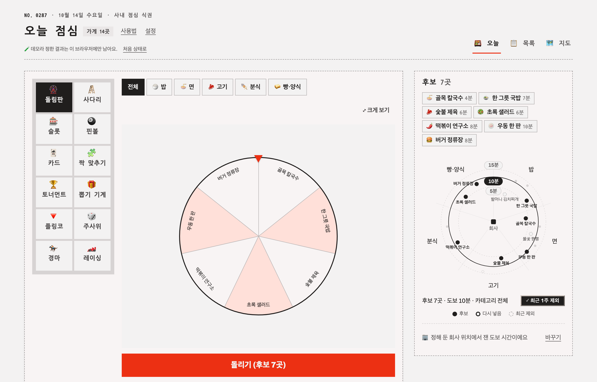
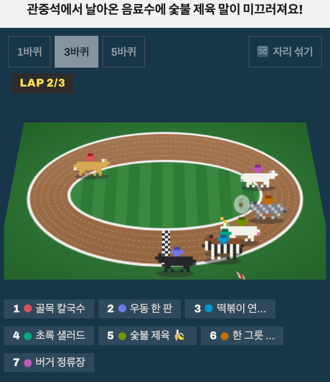
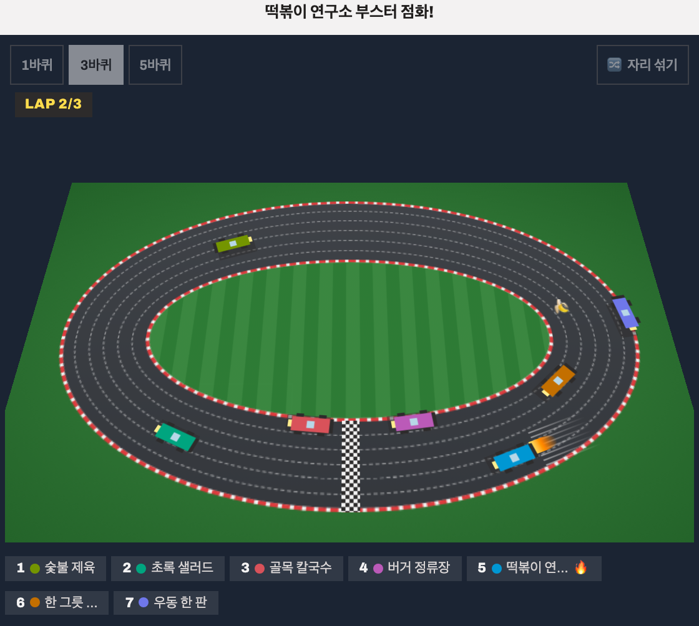
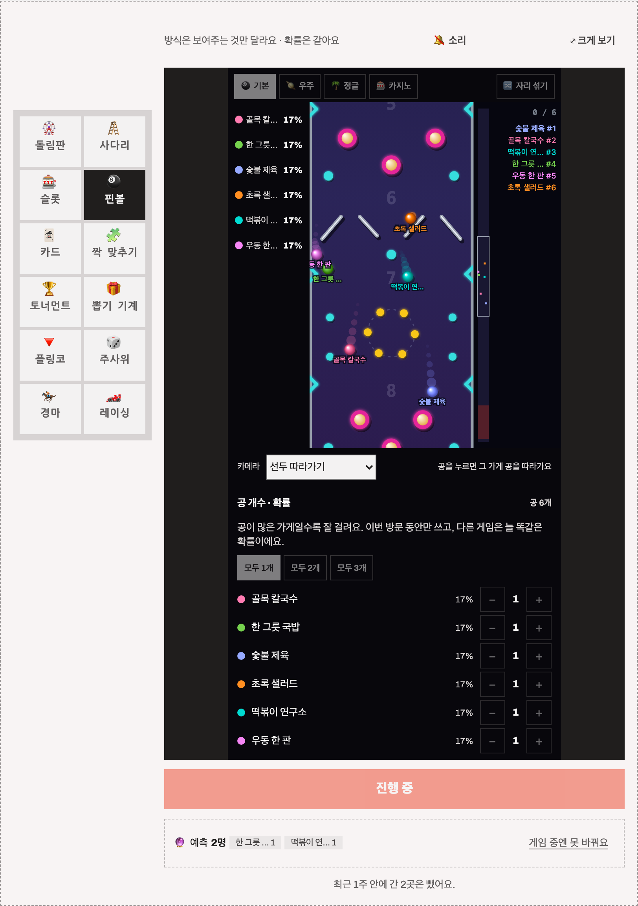
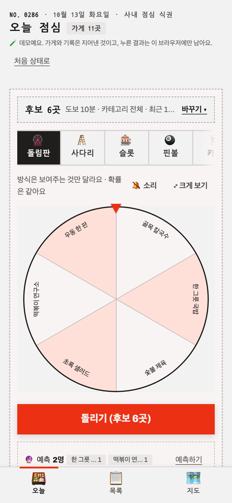
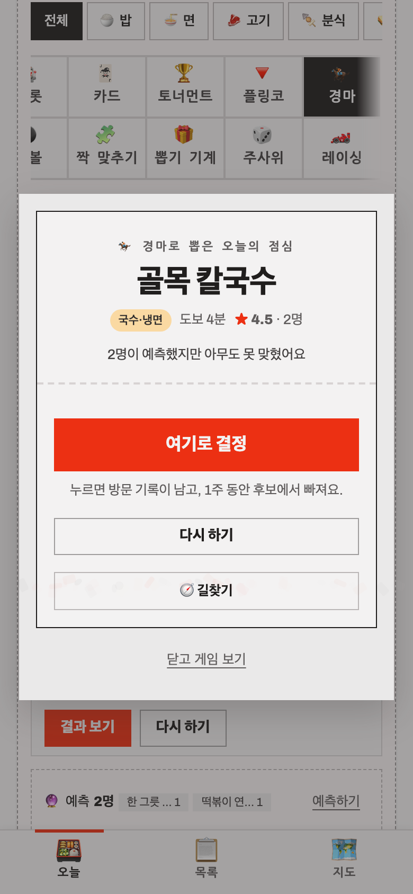
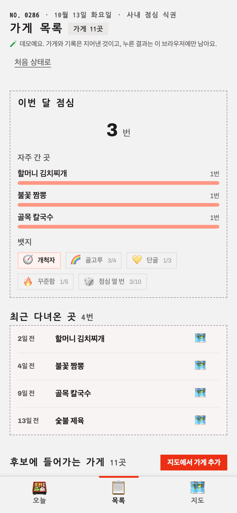

# lunch-app

**점심 메뉴를 게임 한 판으로 정하는 사내용 웹앱 — 최근 1주에 간 곳은 빼고, 결과는 공정하게.**

<sub>React 19 · TypeScript · Vite · Firebase(Firestore·익명 로그인) · 카카오맵 · MODUL 디자인 시스템 · Vitest</sub>

[Demo](https://lunch-app-fawn.vercel.app) · [설계 노트](docs/design.md)



---

점심 메뉴 고르기를 조금 더 재미있게, 그리고 덜 한쪽으로 쏠리게 하려고 만들었습니다. 링크 하나로 열고, 로그인 없이 게임을 골라 돌리면 오늘 점심이 정해집니다. 정한 곳은 기록되어 다음 1주 동안 후보에서 빠지므로, 같은 집만 가는 일이 줄어듭니다.

게임은 열두 가지(돌림판·사다리·슬롯·핀볼·카드·짝 맞추기·토너먼트·뽑기 기계·플링코·주사위·경마·레이싱)이지만 **당첨을 정하는 곳은 한 군데**입니다. 게임은 이미 정해진 결과를 보여 주기만 하고, 그래서 어떤 게임을 골라도 확률이 같습니다. 핀볼은 가게마다 공 개수를 바꿔 확률을 직접 조절하는 게임으로, 확률을 화면 왼쪽에 늘 보여 줍니다.

공개 데모는 서울시청 주변의 지어낸 가게 13곳으로 돌아가고, 누른 결과는 그 브라우저에만 남습니다. 실제 회사 위치나 팀 기록은 들어 있지 않습니다.

## 화면

| 경마 | 레이싱 | 핀볼 |
|:--:|:--:|:--:|
|  |  |  |
| 품종 여덟 가지, 관중이 던진 음료수에 미끄러지는 말 | 3D 타원 서킷, 부스터·펑크·전복·충돌 | 공 개수가 곧 확률, 누른 공을 카메라가 따라감 |

| 오늘 (휴대폰) | 결과 | 목록 |
|:--:|:--:|:--:|
|  |  |  |
| 게임 무대가 먼저, 조건은 그 아래 | 결정·길찾기·동료에게 알리기를 한 장에 | 이번 달 기록·뱃지와 최근 다녀온 곳 |

## 주요 기능

- **게임 열두 가지** — 고르는 재미는 게임마다 다르고 확률은 같습니다. 경마·레이싱은 바퀴 수(1·3·5)를 고르고 출발 자리를 섞을 수 있으며, 순위표 이름을 누르면 카메라가 그 주자를 따라갑니다.
- **후보 로드맵** — 반지름은 도보 시간, 각도는 카테고리인 그림이 그대로 필터입니다. 후보·다시 넣음·최근 제외·조건 밖·꺼짐을 구분해 "무엇이 왜 빠졌는지"를 보여 줍니다.
- **카테고리 칩** — 게임판 바로 위에서 "오늘은 한식만"처럼 고르면 그 카테고리 가게만 후보가 되고, 어떤 게임이든 그 후보로 돕니다. 로드맵과 같은 조건이라 어느 쪽에서 바꿔도 맞춰집니다.
- **사람마다 별점** — 기기(익명 로그인)마다 가게당 한 표씩 별점·한줄평을 남기고, 목록·지도 핀·결과에 "★ 4.3 · 3명"처럼 평균을 보여 줍니다. 예전에는 가게에 별점이 하나뿐이라 마지막에 고친 사람 점수로 덮였습니다. 별점은 참고용이고 당첨에는 쓰지 않습니다.
- **최근 방문 제외** — 최근 1주에 간 곳은 빼되, 후보가 5곳보다 적어지면 오래된 방문부터 도로 넣고 "다시 넣음"으로 따로 표시합니다.
- **지도** — 카카오맵 검색으로 가게를 넣거나 지도를 길게 눌러 핀을 꽂습니다. 결과에서 카카오맵 도보 길찾기를 바로 엽니다.
- **첫 방문 안내** — 처음 들어오면 설명하는 곳만 밝히는 5단계 안내(카테고리 칩 → 게임 고르기 → 돌리기 → 목록·지도)가 뜹니다. 한 번 보면 다시 뜨지 않고, 머리말의 "사용법"으로 언제든 다시 봅니다.
- **같이 쓰는 장치** — 동료 예측(맞힌 사람 표시), 동료에게 알리기(공유 시트·클립보드), 이번 달 기록과 뱃지. 셋 다 당첨에는 영향이 없습니다.

## 공정성 — 당첨은 한 곳에서만

`App.tsx` 의 `spin()` 이 `selectCandidates()` 결과에서 균등 난수로 당첨을 먼저 정하고, 게임은 그 결과에 도달하는 연출만 맡습니다. 게임이 직접 결과를 계산하면 "최근 1주 제외"의 근거가 무너지고, 후보 산출 테스트도 의미를 잃습니다.

연출이 정해진 결과에 닿는 방법은 게임마다 다릅니다. 핀볼과 경주는 **경기를 한 번 실제로 만든 뒤 1등의 이름표(기록)를 당첨과 맞바꾸고**, 사다리·카드는 사용자가 고른 칸에 당첨을 놓고 나머지를 섞어 엽니다. 핀볼은 처음엔 당첨이 이기는 시드를 찾을 때까지 경기를 반복했는데, 판을 1840px 로 늘리자 후보 20곳에서 출발 전 최대 7.9초가 멈췄습니다. 이름표 맞바꾸기로 바꾼 뒤에는 경기를 한 번만 돌립니다.

물리를 그대로 믿지 않은 이유도 있습니다. 핀을 한쪽으로 엇갈리게 깔았을 때 오른쪽 끝 구슬은 600 시드 중 한 번도 이기지 못했습니다. 지금 코스는 좌우 대칭이고, 대칭이 깨지면 테스트가 잡습니다. 게임별 방식은 [설계 노트](docs/design.md#게임-12종--연출만-다르고-결과는-하나)에 정리했습니다.

## 데모와 팀용 — 같은 코드, 두 가지 빌드

| | 공개 데모 | 팀용 |
|---|---|---|
| 데이터 | 브라우저 저장소(`localStorage`) | Firestore + 익명 로그인 |
| 가게 | 서울시청 주변 지어낸 13곳 | 팀이 지도에서 넣은 가게 |
| 빌드 | `VITE_DEMO=1` | Firebase 환경변수 |

`src/services/lunch.ts` 가 빌드 설정으로 `lunch.demo.ts` 와 `lunch.firebase.ts` 중 하나를 고릅니다. 조건을 빌드 때 상수로 접으므로 데모 빌드에는 Firebase SDK 가 없고, 팀용도 Firebase 를 나중 청크로 받습니다. 첫 묶음이 912KB 에서 374KB 로 줄었습니다(2026-10-13, `vite build`).

## 실행

```bash
pnpm install        # MODUL 패키지가 GitHub Packages 에 있어 read:packages 토큰이 필요합니다
pnpm dev:demo       # Firebase 없이 데모 데이터로 실행
```

팀용으로 돌리려면 `.env.example` 을 `.env.local` 로 복사해 Firebase·카카오 키와 회사 좌표를 채운 뒤 `pnpm dev` 를 실행합니다. 에뮬레이터로 확인하려면 `pnpm dev:emu` 를 씁니다.

| 명령 | 하는 일 |
|---|---|
| `pnpm dev:demo` | 데모 데이터로 개발 서버 |
| `pnpm dev` / `pnpm dev:emu` | Firebase / 에뮬레이터로 개발 서버 |
| `pnpm test` | 단위·컴포넌트 테스트 (Firebase 없이 실행) |
| `pnpm test:rules` | Firestore 규칙 테스트 (에뮬레이터를 직접 띄움) |
| `pnpm build` / `pnpm build:demo` | 팀용 / 데모 빌드 |

카카오맵은 콘솔에 등록한 도메인에서만 열립니다. 새 주소에서 지도가 안 뜨면 카카오 개발자 콘솔의 Web 플랫폼 도메인을 먼저 확인해 주세요.

## 검증

- Vitest 단위·컴포넌트 테스트 399개 — 경주는 후보 수·당첨·시드 조합마다 당첨이 단독 1등인지, 핀볼은 테마별로 판이 대칭이고 모든 구슬이 완주하는지 확인합니다.
- Firestore 규칙 테스트 — 날짜가 KST 오늘인지, 자기 예측만 쓰는지, 가게는 지울 수 없는지를 에뮬레이터에서 확인합니다.
- 화면을 바꿀 때마다 Playwright 스크립트로 휴대폰(390px)·데스크톱(1280px)에서 결정까지 돌려 보고 콘솔 오류가 없는지 확인했습니다.

## 회고와 남은 제약

처음에는 돌림판 하나로 시작해 게임을 하나씩 늘렸습니다. 게임마다 결과를 따로 계산하면 게임에 따라 확률이 달라질 수 있어서, 당첨을 한 곳에서 정하고 게임은 연출만 하는 경계를 먼저 굳혔습니다. 나머지 게임 열한 가지는 이 경계 안에서 추가했고, 새 게임마다 "당첨이 반드시 이긴다"는 테스트를 같이 붙였습니다.

- 도보 시간은 직선거리 × 1.3 ÷ 67m/분으로 추정합니다. 실제 걸어 본 시간과 2분 넘게 차이 나는 가게가 늘면 카카오 길찾기 시간으로 바꿀 계획입니다.
- Firestore 규칙에는 집계가 없어 문서 수 상한을 걸지 못했습니다. 링크를 아는 사람은 누구나 쓸 수 있으므로, 가게 삭제를 막아 복구 가능성을 지키는 것으로 대신했습니다.
- 게임 열두 가지 중 무엇이 실제로 쓰이는지는 아직 기록하지 않습니다. 쓰이지 않는 게임을 정리하려면 사용 기록부터 남겨야 합니다.
